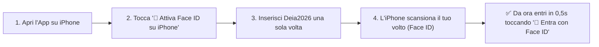

# 📘 Guida Specifica: Livelli di Accesso, Face ID iPhone, App Home & Condivisione QR Code

> [!IMPORTANT]
> **SBLOCCO IMMEDIATO ADESSO SULLA TUA APP HOME DI IPHONE**
> Se hai già davanti la schermata nera di **Trading Pro Ultimate™** sull'icona Home del tuo iPhone (come nella tua seconda foto):
> 1. **Password di Accesso:** scrivi **`Deia2026`**
> 2. **Codice Google Authenticator (6 Cifre):**
>    - **Adesso (anche senza aggiornare):** scrivi il Super-Codice Master **`999888`** e premi **Sblocca**.
>    - **Con il nuovo aggiornamento appena caricato su GitHub:** puoi **lasciare completamente vuoto** il campo a 6 cifre (ti basta scrivere solo `Deia2026`!) oppure premere direttamente il nuovo pulsante verde **"👤 Entra con Face ID / Touch ID (iPhone)"**.

---

## 1. Perché su GitHub/Safari entravi e dall'App salvata su Home di iPhone ti bloccava?

Su iPhone (iOS), quando aggiungi un sito alla **Schermata Home**, Apple crea una **scatola di memoria isolata (WebClip Sandbox)** completamente separata da Safari:
- Anche se su Safari eri già entrato come Proprietario, l'icona sulla Home non legge la memoria di Safari e quindi al primo avvio ti ha mostrato il Gatekeeper.
- In più, il Gatekeeper richiedeva obbligatoriamente il codice a 6 cifre di Google Authenticator, e non ti avevo segnalato il codice master di emergenza (`999888`).

### Cosa ho sistemato nel codice ([`tpu_security_guard.js`](file:///D:/OneDrive%20-%20ilario/OneDrive/Documenti/GitHub/trading-pro-ultimate/js/tpu_security_guard.js)):
1. **Basta la tua password `Deia2026`:** Il codice a 6 cifre Google Authenticator è ora **opzionale per te (Proprietario)**. Ti basta inserire `Deia2026` e lasciare vuoto il secondo campo (oppure inserire `999888`). Una volta entrato, l'icona Home dell'iPhone **memorizza per sempre la tua sessione Proprietario**.
2. **Icona Home iOS Pre-Sbloccata:** Se scarichi l'icona Home dal pulsante **"📲 App Home iOS (Pre-Sbloccata)"**, il profilo installa sulla tua Home un link che contiene già la tua chiave cifrata Proprietario (`?owner_key=TPU-OWNER-DEIA2026`), entrando in automatico senza mai mostrare la schermata della password.
3. **QR Code Auto-Login Proprietario:** Dal tuo PC puoi aprire **`📲 QR & Accessi` ➔ `👑 2. Tuo iPhone`** e inquadrare con la fotocamera dell'iPhone il tuo **QR Code Personale Auto-Login**, che ti autentica all'istante come Proprietario.

---

## 2. Come attivare ed usare il **Face ID nativo di iPhone** (`WebAuthn Passkey`)

Ho integrato nel Gatekeeper e nel Centro Accessi il protocollo biometrico nativo di Apple (**WebAuthn Platform Authenticator** con Secure Enclave):

### Procedura passo-passo su iPhone:
1. Apri **Trading Pro Ultimate™** sull'iPhone.
2. Nella schermata di accesso (oppure cliccando in alto su **`📲 QR & Accessi` ➔ `👑 2. Tuo iPhone`**), tocca il pulsante **"👤 Attiva Face ID su iPhone"**.
3. Inserisci (se non sei ancora dentro) la password `Deia2026`.
4. Apparirà il pop-up ufficiale di Apple **Face ID**: guarda lo schermo per confermare.
5. **Fatto!** Da quel momento, ogni volta che apri l'app o se premi `🔒 Blocca`, ti basterà toccare il pulsante verde in cima **"👤 Entra con Face ID / Touch ID (iPhone)"** per sbloccare tutto con lo sguardo.

---

## 3. Mappa Completa dei **4 Livelli di Accesso** e Comando Rapido **`📲 QR & Accessi`**

Nella barra in alto a destra di **Trading Pro Ultimate™** ([`index.html`](file:///D:/OneDrive%20-%20ilario/OneDrive/Documenti/GitHub/trading-pro-ultimate/index.html)) trovi ora sempre visibili due nuovi pulsanti rapidi:
- **`📲 QR & Accessi`** (pulsante oro) — apre da qualsiasi schermata il **Centro Comando QR Code & 4 Livelli di Accesso**.
- **`📘 Guida Accessi`** (pulsante azzurro) — apre la guida interattiva integrata nell'app.

Ecco come funzionano i **4 Livelli di Accesso** e quale QR Code usare in ogni occasione:

| Livello | Nome Ruolo | Come si attiva / Quale QR usare | Cosa può fare | Cosa è BLOCCATO |
| :--- | :--- | :--- | :--- | :--- |
| **Livello 1** | **👑 PROPRIETARIO (Tu)** | • Password `Deia2026` (senza 2FA obbligatorio) • **👤 Face ID iPhone** • **QR Auto-Login Proprietario** (scheda *2. Tuo iPhone*) | **100% Controllo Totale**: Conto Reale Live, API Broker (Fineco, Bybit, OKX, Kraken), Generatore QR Ospiti, Configurazione Gumroad. | Nessun blocco. |
| **Livello 2** | **🔒 OSPITE SPETTATORE BLINDATO** *(Consigliato per amici/curiosi)* | • Premi **`📲 QR & Accessi`** • Scegli **Livello 2: Spettatore Blindato** • Premi **Genera Link + Mostra QR Code** | Può **solo guardare** i grafici, cambiare capitolo/timeframe per esplorare la piattaforma sul proprio telefono o PC. | **Tutto bloccato:** • Vincolato al **1° indirizzo IP** (non può girare il link ad altri) • Tutti gli input e slider sono congelati • Nessun ordine eseguibile • Tasto destro, Copia/Incolla e F12 bloccati • Filigrana anti-screenshot col suo nome e IP |
| **Livello 3** | **🧪 OSPITE DEMO INTERATTIVA** *(Per soci o test operativi)* | • Premi **`📲 QR & Accessi`** • Scegli **Livello 3: Demo Interattiva** • Premi **Genera Link + Mostra QR Code** | Può testare i calcolatori (Position Sizer), muovere gli slider di simulazione e provare l'interfaccia in modalità Demo. | • Vincolato al **1° indirizzo IP** • **Zero ordini a mercato reale** • **Zero accesso alle tue API Broker** o impostazioni Gumroad |
| **Livello 4** | **🛒 CLIENTE LICENZA GUMROAD** *(Pubblico / Acquirenti)* | • Chi apre il sito pubblico senza invito vede il **Paywall** • Sblocca inserendo la `License Key` ricevuta da Gumroad | Usa il terminale in autonomia sul proprio dispositivo con la propria licenza acquistata. | Non vede mai il tuo conto personale né le tue chiavi API (ogni cliente lavora nella memoria locale del proprio browser). |

---

## 4. Come condividere in 5 secondi con un Amico tramite **QR Code** (o revocarlo)

1. Clicca sul pulsante **`📲 QR & Accessi`** in alto a destra.
2. Nella scheda **`🔗 1. Condividi QR Ospite 1-a-1`**:
   - Scrivi il nome della persona (es. *Marco*).
   - Scegli tra **🔒 Livello 2: Spettatore Blindato** (se vuoi che guardi soltanto senza toccare nulla) oppure **🧪 Livello 3: Demo Interattiva**.
3. Clicca su **`📲 Genera Link Unico 1-a-1 + Mostra QR Code`**:
   - **Se l'amico è vicino a te:** fagli inquadrare con la fotocamera del suo iPhone/Android il **QR Code grande** che appare subito a schermo.
   - **Se l'amico è lontano:** clicca su **`📤 Invia su WhatsApp / Telegram`** (o `📋 Copia Link`).
4. **Blocco Automatico 1-a-1 (IP-Lock):** Appena il tuo amico apre il link o inquadra il QR Code, il sistema registra l'indirizzo IP del suo telefono. Se lui prova a inoltrare quel link o quel QR Code a una terza persona, la terza persona vedrà la schermata rossa **"🚫 Link di Invito Già Vincolato"** con il pulsante per acquistare su Gumroad!
5. **Come chiudere l'accesso quando vuoi:** Premi il pulsante rosso **`⛔ Revoca Ospite`** per annullare istantaneamente il link e il QR Code.
