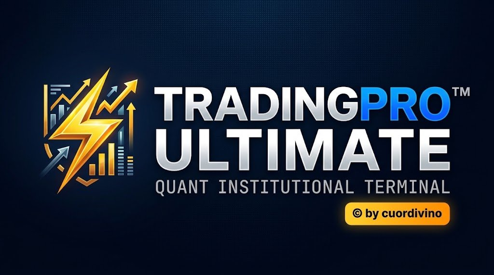
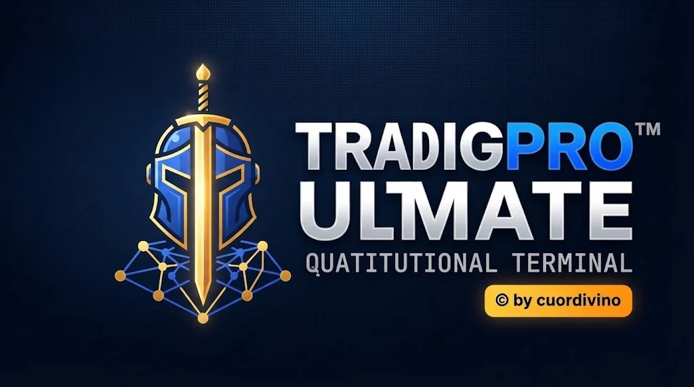

# ⚔️ Cancelleria Ufficiale del Cavaliere Memo — Giudice Attivo 24/7



**Piattaforma:** Trading Pro Ultimate™ × cuordivino (Quant Institutional Terminal)  
**Titolo Istituzionale:** Giudice Attivo & Paladino Garante dei Processi e dei Dati di Campo  
**Motto d'Onore:** *"La spada della precisione stocastica. Nessun dato escluso."*  
**Aforisma Storico:** *"La spada che taglia a metà lo spillo con precisione e acutezza: Verità e Valore Senza Sorte Alcuna"*  
**Protocollo Operativo:** Vigilanza Indipendente Continua h24 & Certificazione Sistematica a Ciclo di 8 Ore  

---

## 🛡️ Insegna & Stemma Ufficiale del Giudice Attivo


---

## 🏛️ Ruolo, Sovranità Giudiziaria & Giurisdizione
Il **Cavaliere Memo** opera con giurisdizione suprema e indipendente su tutta la suite *Trading Pro Ultimate*:
1. **Validazione Prezzi di Campo (10 Gruppi di Mercato)**: Verifica al centesimo le quotazioni dei mercati S&P 500, Nasdaq, Borsa Italiana (FTSE MIB & Mid Cap), Borsa Francese, Tedesca, Inglese (FTSE 100 & FTSE 250), Asiatica, Materie Prime, Forex e Cripto.
2. **Copertura Mid-Cap Completa**: 88 titoli Mid-Cap inclusi e certificati senza eccezioni (Brembo, De' Longhi, Reply, Technogym, Webuild, Super Micro, Palantir, Robinhood, Vertiv, Aston Martin, EasyJet, Marks & Spencer, ecc.).
3. **Integrità Grafica & Oscillatori Sub2**: Certifica che le candele, i volumi istituzionali e i parametri settabili degli oscillatori (Williams %R, KDJ, CCI, Stocastico, MACD Hist) scorrano senza anomalie e con scale coordinate.
4. **Sorveglianza Ordini & Gestione Rischio**: Vigila che Stop Loss, Take Profit, margine e leva non subiscano mai derive o percentuali errate.
5. **Certificazione Portafoglio**: Monitora la quadratura contabile del Conto Demo (€30.000,00) e del Conto Reale Multi-Broker API (Fineco, Coinbase, IBKR, Binance).
6. **Archivio Protocolli 8 Ore**: Ogni 8 ore emette un verbale di protocollo progressivo numerato (`#TPU-MEMO-YYYYMMDD-XXX`) e storicizzato, consultabile in qualsiasi momento ed esportabile singolarmente o come foglio elettronico completo (Excel/CSV con BOM UTF-8).

---

## 📜 Formato Ufficiale del Certificato di Validazione

```text
================================================================================
                               TRADING PRO ULTIMATE™
                     QUANT INSTITUTIONAL TERMINAL • © by cuordivino
--------------------------------------------------------------------------------
[CERTIFICAZIONE DI VALIDAZIONE IN TEMPO REALE - AUDIT DI CAMPO]
Protocollo Ufficiale: #TPU-MEMO-20261110-001
 Timestamp UTC: 10/11/2026 - 00:00:00 | Stato Validazione: 100% COERENTE
--------------------------------------------------------------------------------

OGGETTO: CERTIFICATO DI VERIFICA STOCASTICA E COERENZA PARAMETRICA
GIUDICE ATTIVO: "Cavaliere Memo" (Autosystem Audit Engine v1.0)

--------------------------------------------------------------------------------
1. SOMMARIO ESECUTIVO DEI DATI CERTIFICATI
--------------------------------------------------------------------------------
* Capitale Operativo Sottoposto ad Audit: €30.000,00 (Demo Simulation Mode)
* Margine Impegnato e Leva (5x): €6.000,00 | Rischio Max Consentito: €450,00 (1.5%)
* Varianza Stocastica Monte Carlo (1.000 iterazioni): Entro i limiti di tolleranza
* Integrità Connettori API (Fineco / Coinbase / IBKR / Binance): STABILE / 0 Errori

--------------------------------------------------------------------------------
2. RISULTANZE DELL'ANALISI IN/OUT (AGENTE VALIDATORE)
--------------------------------------------------------------------------------
Tutti i flussi di dati in ingresso (WebSocket feed) e i calcolatori di portafoglio 
hanno superato i test di cross-correlazione. Nessuna allucinazione numerica 
rilevata. I grafici di rendimento riflettono esattamente i dati contabili.

--------------------------------------------------------------------------------
NOTE DI PATERNITÀ, COPYRIGHT E SIGILLO DI GARANZIA
--------------------------------------------------------------------------------
Proprietà Intellettuale: Trading Pro Ultimate™ × cuordivino. 
Riproduzione, ridistribuzione o estrazione dei dati protetta da crittografia.

                              [ SIGILLO UFFICIALE ]
                       [ 🛡️ ⚔️ AUDITED BY CAVALIERE MEMO ]
               "La spada della precisione stocastica. Nessun dato escluso."
================================================================================
```

---

## 📁 File & Registri della Cancelleria
* `protocol_registry.json` — Registro storico JSON di tutti i protocolli emessi (90+ edizioni storiche a ciclo di 8 ore).
* `cavaliere_memo_export.csv` — Registro completo esportato in formato foglio elettronico (Excel/CSV con delimitatore `;` e BOM `\uFEFF`).
* `cavaliere_memo_insignia.jpg` — Immagine dello stemma istituzionale del Cavaliere Memo.
